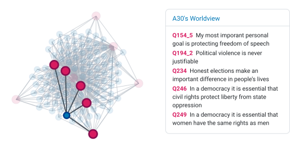
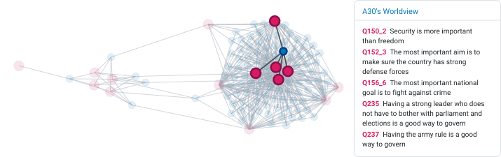
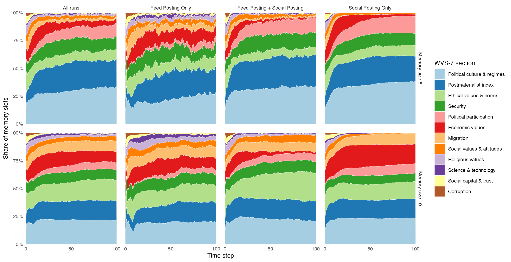

```{r}
#| include: false
library(tidyverse)
library(arrow)
library(readxl)
library(glue)
library(patchwork)
library(ggh4x) # Hacks for ggplot, here to make facets different widths
library(gt)
library(ggiraph)

memory <- read_parquet("../parquet/memory.parquet")
runs_core <- read_parquet("../parquet/runs_core.parquet")
statements_meta <- read_parquet("../parquet/statements_meta.parquet") |>
  rows_update(
    read_csv("../rawdata/gpt54_binary_classification.csv") |>
      select(S_id = id, worldview),
    by = "S_id"
  )
wvs <- read_parquet("../parquet/wvs.parquet")
load("../parquet/PCAall.Rdata")
PC1s <- read_parquet("../PC1s.parquet")
runs_annotations <- read_xlsx("../rawdata/runs_annotations.xlsx")
load("../parquet/PCAall.Rdata")
# sttmts <- read_parquet("sttmts.parquet")
```


# Introduction

Deliberative processes are essential to ensuring the effective translation of citizen preferences to policy. Studying the dynamics of opinion change and stability at micro and macro scales can help identify the conditions under which deliberation produces informed and coherent collective outcomes. This project focuses on how individuals’ views may change, stabilize, or become more isolated as they encounter opinionated statements through different information channels. We are particularly interested in the emergence of filter bubbles and polarization as a result of repeated exposure to statements flowing into an agent’s feed from news media and social networks. We use LLMs to mimic human behavior in a simplified way. In an AI-augmented democracy, human deliberators may be assisted by LLMs, or deliberation may be fully outsourced to LLM representatives. Therefore, it is also of interest to understand the dynamics of deliberating LLMs.  

Agent-based models (ABMs) are useful tools for studying opinion dynamics and implications for deliberative processes, especially for explaining the emergence of macro level phenomena such as filter bubbles. Conventional opinion dynamics ABMs often represent opinions as points in a low-dimensional numerical space where distance between two points measures the difference of opinion @GeschkeEtAl2019TriplefilterBubbleUsing. Our approach in this project instead uses natural language opinion statements, and agents that can understand and act on natural language statements. Statements transform from points in two-dimensional numerical space to textual statements. Instead of linking to numerical positions, agents maintain a list of statements as their worldview. The behavioral mechanisms of integrating and dropping statements are prompted to an LLM. The LLM responds with a structured output and the agent's integration and dropping decisions can be executed in the simulation timeline. 

Technically, the model consists of agents embedded in a social network where all agents are initialized with a fixed number of opinion statements. Each agent has a bounded memory containing a limited number of opinion statements, which together represent that agent’s worldview. Statements originate from a statement pool, which is built using the World Values Survey questionnaire as the basis. At each time step, agents are exposed to statements from a shared feed and/or to statements circulated by their network neighbors. In both cases they then decide whether to integrate one of these statements into memory or reject all candidate statements. If their memory is full, adopting a new statement requires dropping an existing one. Agents can share statements from their own memory with their neighbors. 

Our approach differs from persona-based LLM simulations, which have been the preferred approach to simulating human behavior with LLMs [@ArgyleEtAl2023OutOneMany; @PromaEtAl2026CanLLMsEmulate]. Rather than assigning agents fixed demographic profiles or ideological labels, and instructing them to return responses to a set of behavioral questions, we represent their worldview as an evolving memory of statements and ask them to accept or reject new statements given their worldview at the time of decision. Agents are not predefined as liberals, conservatives, moderates, or members of specific social groups. Their worldviews develop through repeated exposure, uptake, replacement, and sharing. This matters for deliberation research because deliberation is precisely a process through which preferences and identities may change.

Opinion dynamics is an established and prominent approach to agent-based modeling of socio-political systems [@FlacheEtAl2017ModelsSocialInfluence; @LorenzEtAl2021IndividualAttitudeChange]. Models of opinion dynamics have been used to understand the mechanisms of societal radicalization and polarization, and the emergence of filter bubbles in various ways [@KeijzerMaes2022ComplexLinkFilter; @KeijzerEtAl2026ComputationalSocialScience]. A shortcoming of opinion dynamics models has always been that something as complex as the opinion of a human being has to be boiled down to one number or to a vector of few numbers in an abstract numerical opinion space such as the left-right political continuum. 

While numerical opinion spaces may seem disconnected from the reality of how opinions exist in the real world, they are not arbitrary model design choices. Researchers measure individuals' attitudes through representative surveys, where individuals self-assess their attitudes on numerical or categorical scales. In addition, actors in political discourse in the real world use spatial metaphors such as a politician moving to the right, left, or center. Accordingly, political science has developed several methods for positioning political actors and texts in low-dimensional numerical opinion spaces. These methods range from expert assessments using theory-driven classification to data-driven approaches measuring positions in latent dimensions of higher-dimensional spaces using roll-call, co-voting data, survey data, or texts using dimensionality reduction and natural language processing. The well-known models of continuous opinion dynamics [see @Lorenz2025ExploringTheoryAgentbased] make use of such abstract low-dimensional opinion spaces and define how individuals change their opinion on that scale when confronted with the opinions of others. However, in reality, an attitude change does not occur through the exchange of numbers but through verbalization of arguments [@BanischOlbrich2019OpinionPolarizationLearning], persuasive messages, and emotional emphasis, whether written or spoken language, or other media such as images. While it is plausible that the attitudes of individuals can be mapped reasonably well into a low-dimensional numerical space for descriptive purposes, it is less realistic that individual attitude change can be well operationalized solely based on just the exchange of numbers.

Large Language Models (LLMs) provide a new opportunity to build a new generation of opinion dynamics models. LLMs trained on large bodies of text seem to have embedded the meaning of the antagonisms and compatibilities of opinions as stated in written texts.
In this paper, we build such a model inspired by the filter bubble model of @GeschkeEtAl2019TriplefilterBubbleUsing. The main entities in their model are agents positioned in a two-dimensional numerical opinion space, and opinionated statements represented by *bits of information* which are also points in the same opinion space. Agents are linked to a limited number of bits of information which together represent their worldview. Their positions are defined by the coordinates in the opinion space that correspond to the average position of their worldview. Further on, agents maintain a social network of bidirectional friendship links. Based on this setup, agents have a few behavioral mechanisms implemented. When they are presented with a new point in opinion space, either from a central media channel or their friends, they decide whether to integrate it into their worldview or not. If they integrate it they drop another bit of information. With a change of bits of information they adjust their position in opinion space to the new worldview average. They can share a bit of information from their worldview along all their friendship links, mimicking its posting on social media.

The macroscopic opinion landscape of agents and statements in the model is thus a bipartite network of agents and statements, where agents are linked to the bits of information of their worldview, and bits of information are linked to the agents that have them in their worldview. In such an opinion landscape, a *bubble* is a set of agents whose worldviews have a high overlap of statements while the overlap with all other agents is low or non-existent. 

The model shows emergent phenomena and how they depend on model parameters. Firstly, when new bits of information come in from a central media source which every agent can see, the opinion landscape develops a structure characterized by high and low density regions but the network remains fully connected without strong bubbles. Secondly, when agents are able to see statements shared by friends, the opinion landscape develops a structure characterized by bubbles. Thirdly, how many bubbles emerge depends to a large extent on a parameter called latitude of acceptance which defines how far away a statement can be from the average position of an agent's worldview to be integrated. When this latitude is small, many small bubbles emerge. When it is large enough, only one large bubble emerges. 

We transform this model into a text-based setup without a numerical opinion space. Statements transform from dots (information bits) in two-dimensional numerical space to textual opinionated statements. Instead of linking to numerical positions, agents maintain a list of statements in their memory as their worldview. The behavioral mechanisms of integrating and dropping statements are performed by LLM agents based on instructions passed to them through their system prompt. 

In this study, we use a limited set of 100 statements extracted from the World Values Survey questionnaire. Each statement is directly related to one survey item and to a certain response or response scale. This approach facilitates the validation of emerging worldviews in LLM simulations with real survey responses.

The phenomena we aim to study with this model are on different levels. On macro level phenomena our main questions focus on whether the textual representation of opinions and the use of LLMs for integration and dropping decisions lead to a similar bubble formation phenomenon as the numerical model, whether the presence or absence of social posting of statements by friends is similarly relevant for the emergence of bubbles, and whether we can observe new phenomena emerging in the text-based model which were not present in the numerical model. On the micro level (i.e. agents and statements), we investigate which statements LLM agents prefer to integrate into their worldview, to which worldviews LLM agents converge when they interact with each other, and whether they have ideological or thematic biases when they evaluate opinionated statements. 

Our preliminary results from 108 runs covering a large range of experimental configuration space show that bubbles of worldviews can also emerge in LLM-based opinion dynamics simulations. Bubbles can appear when there is only feed posting in a simulation run, but their bubbleness becomes more pronounced when agents can share statements with other agents through social posting. Our statement level analysis indicates that agents' attention to statements depends on the information sharing mode (i.e. feed posting vs. social posting) and the thematic content of statements.          

# Simulation Setup and Data

The implementation of the agent-based model using LLMs for agents' worldview integration decisions mostly follows the outline by @LorenzGunes2025FilterBubblesAgentbased.
We developed a simulation setup in which LLM agents are repeatedly presented with statements coming from feed posting and social posting channels, and asked to make decisions on whether to accept, reject, and what statement to drop if the memory is full. Our setup allows us to control through which channels agents will observe statements. Agents can observe and act on statements coming from a central feed or on statements coming from friends. In this work, we study scenarios where one or both of these channels are activated. 

In the initialization stage, agents are assigned a memory with a single random statement from a statement pool with 100 statements as listed in @tbl-statements, where each item is a statement derived from the questionnaire of World Values Survey Wave 7 [@HaerpferEtAl2022WorldValuesSurvey]. Initialization also determines agents' friendship network and what statements they will see in the central feed of the first time step. They are initialized with on average 10 random friendship links, which remain constant throughout the simulation. When social posting is activated, in each time step agents will also share a random statement from their memory with linked agents. Before starting LLM interaction with statements and other agents, three statements are randomly selected in each time step from the same statement pool and presented to agents as feed statements.

Some other important configuration parameters that we vary across our experimental runs are openmindedness and memory size. We include an openmindedness description in the system prompt which tells the agent how strict its integration behavior must be when it sees a new statement which does not exist in its memory. This parameter ranges from 0 to 10, where 0 represents full closed mindedness and 10 represents full openmindedness. Agents are presented with the list of statements they ended up with at time step *t - 1* as their memory in time step *t*. We control the number of statements they can hold in their memory with the memory size parameter, which we hold constant across agents within an experimental run, but can vary across runs.

Agents get information about task instructions and statements in a system prompt. We present an example system prompt in @sec-prompt. The structure of prompts remains the same across all LLM calls, but only the statements in agents' memory and what set of statements they get from central feed and their friends change. They process the information passed to them in the system prompt, and they return a JSON object containing structured output about their integration and dropping decisions. 
 
The statement pool is where the statements originate from. We used a collection of statements derived from the World Values Survey (WVS) questionnaire, which covers a wide range of topics and contains questions that can be transformed into worldview statements. In some cases, we generated multiple statements from a single WVS question. For example, for some questions, we generated statements representing the two opposing ends of the response scale, or we generated different statements from a rank order question. In total, we derived 100 statements from 88 questions. Each statement is linked to a specific question in the WVS questionnaire, so that we can compare simulation outcomes to the empirical survey data. The full list of statements is shown in @tbl-statements along with corresponding WVS question IDs. 

We capture simulation output in several structured datasets and a log file which contains all raw information generated during a simulation run. Together, these data let us rebuild the state of the opinion landscape at any time step and trace each change in an agent’s worldview back to the LLM decision that caused it. In the following section, we use them to examine the macro-level structures that emerge in our simulations and the individual choices that produce them. 

# Results

In this section, we present results from 108 simulation runs, covering a systematic set of parameter configurations. Each run features at least one of the information channels: central feed, social posting, or both. Each of the three feed posting and social posting combinations has 36 runs. Within these runs with identical information channel configurations, we vary memory size and openmindedness parameters. For each unique information channel, memory size, and openmindedness configuration, we execute nine simulations, using three different random seeds with three executions each. 

In all experimental runs, we used *gpt-oss-20b* model via OpenRouter. All the results in this section summarize this model's behavior under the different experimental configurations in which it was asked to perform the task. All runs had 100 agents performing the instructed task for 100 time steps. Agents started with a single random statement in the first time step, and grew their memory up to the maximum allowed number of statements. 

{#fig-twobubbles width="100%"}

@fig-twobubbles, @fig-libbubble, and @fig-authbubble show some typical outcomes we observe across simulation runs. These figures show bipartite networks where agents (blue) are linked to statements (red) and which are generated using a layout computed dynamically with a version of the force-directed algorithm [@FruchtermanReingold1991GraphDrawingForcedirected]. A link means that an agent holds the statement in memory, or it integrated this statement to its worldview. A *bubble* is a group of agents with very similar worldviews, built from a few statements that agents outside the group rarely hold. @fig-twobubbles shows the agent-statement network at the final step of a simulation run in which agents could hold up to five statements in their memory and the openmindedness parameter set to 1. This result features a two-bubble situation where two groups of agents with different ideological leanings (conservative/traditional vs. liberal/progressive) emerged during the simulation and persisted until the end of the run.

{#fig-libbubble width="70%"}

@fig-libbubble and @fig-authbubble show a close-up look at a specific agent's memory in two runs with identical experimental configurations and initial conditions. An agent's worldview trajectory may differ across identical configurations and initial conditions, because LLMs are not deterministic. Different LLM decisions in early time steps may cause divergence between agent's behaviors across two identical runs. Because of that, we execute three runs with the same random seed and unique experimental configuration. The societies in these two examples can be essentially characterized as a consensus bubble where almost all agents are linked to a small set of statements. While these two runs with identical parameters both ended up in a consensus-like situation, a close-up look at a specific agent's memory (agent 30) shows that in one of the runs this agent finished with a freedom and equality oriented liberal worldview, while it finished with a more security oriented conservative worldview. Snapshots of all our simulations are available [@LorenzGunes2026JanlorenzFilter_bubbles_llmLogging].

{#fig-authbubble width="100%"}
 

To place statements on a one dimensional ideology scale, we ran a principal component analysis (PCA) on the responses of all WVS respondents in year 2018 (N = 33926). PCA condenses correlated answers into a few underlying dimensions. The first principal component explains 13.5% of the variance and is highly correlated with respondents' left-right self-placement (r = 0.82), so we interpret it as an ideological dimension. We asked an LLM (gpt-5.4) to classify the 100 statements into conservative and progressive categories. LLM's classification mostly overlaps with the first principal component, and disagreements mostly occur near zero. A comparison of PCA results and LLM classification can be seen in @fig-PCA-WVS-statements. 

```{r}
#| label: fig-PCA-WVS-statements
#| fig-cap: "1st Prinicple component for all statement based on World Values Survey data (explained variance 13.4%)."
#| fig-height: 5.5
gg <- statements_meta |>
  arrange(desc(WVS_PC1)) |>
  mutate(S_id = fct_inorder(S_id)) |>
  ggplot(aes(
    x = WVS_PC1,
    y = S_id,
    color = worldview,
    fill = WVS_PC1,
    tooltip = Worldview_Statement,
  )) +
  geom_col_interactive() +
  labs(x = "", y = "", color = "Ideology LLM coded", fill = "WVS PC1") +
  scale_fill_continuous(palette = "RdYlBu", limits = c(-1, 1)) +
  scale_color_manual(values = c("blue", "red")) +
  theme_minimal(base_size = 5) +
  theme(axis.text.y = element_text())

if (knitr::is_html_output()) {
  girafe(
    ggobj = gg,
    options = list(
      opts_toolbar(position = "top", fixed = TRUE)
    )
  )
} else {
  # Static fallback for non-HTML formats (PDF)
  gg
}
```


In @fig-statement-popularity, we show how often each statement is part of a worldview at *t=100* over all simulation runs and parameter settings. The four most popular statements (Q246, Q249, Q234, Q154_5) concern civil rights, equal rights for women, honest elections, and freedom of speech. They form the core of the liberal bubble and lie close to the center of the first principal component, meaning that WVS respondents across the political spectrum tend to endorse them. Statements popular in an authoritarian bubble reach medium popularity, while strongly conservative statements on religion and traditional morality are rarely retained. 


```{r}
#| label: fig-statement-popularity
#| fig-cap: "Popularity of statements at time step 100."
#| fig-width: 6
#| fig-height: 6

## Popular Statements Sim at t=100
stats_pop <- memory |>
  filter(t == 100) |>
  left_join(runs_core, by = join_by(run_id)) |>
  filter(post != "Ffix", N == 100) |>
  left_join(statements_meta, by = join_by(S_id)) |>
  count(run_id, S_id, Worldview_Statement, M, openmindedness, post) |>
  summarize(
    popularity = sum(n),
    .by = c(S_id, Worldview_Statement, M, openmindedness, post)
  )

stats_pop_total <- stats_pop |>
  summarize(popularity = sum(popularity), .by = c(S_id, Worldview_Statement)) |>
  mutate(label = glue("{S_id} {Worldview_Statement}")) |>
  arrange(desc(popularity)) |>
  left_join(
    statements_meta |> select(S_id, WVS_PC1, worldview),
    by = join_by(S_id)
  )
df <- stats_pop_total |>
  slice(1:100) |>
  mutate(
    group = if_else(row_number() <= 50, "Top 50", "51–100") |>
      factor(levels = c("Top 50", "51–100"))
  ) |>
  arrange(group, desc(popularity)) |>
  mutate(
    S_id_ordered = paste(S_id, group, sep = "___"),
    S_id_ordered = fct_inorder(S_id_ordered) |> fct_rev()
  )

pad <- 500 # data-unit space reserved for outside labels, same in both panels
p <- df |>
  ggplot(aes(
    y = S_id_ordered,
    x = popularity,
    label = popularity,
    tooltip = Worldview_Statement
  )) +
  geom_col_interactive(aes(
    color = worldview,
    fill = WVS_PC1,
  )) +
  geom_text(
    aes(
      hjust = ifelse(popularity > 1000, 1.1, -0.1)
    ),
    color = "black",
    size = 2
  ) +
  scale_y_discrete(labels = \(x) sub("___.*$", "", x)) +
  facet_wrap(~group, scales = "free", nrow = 1) +
  scale_x_continuous(
    breaks = c(),
    expand = expansion(mult = 0, add = c(0, pad))
  ) +
  scale_fill_continuous(palette = "RdYlBu", limits = c(-1, 1)) +
  scale_color_manual(values = c("blue", "red", "grey")) +
  labs(y = "", x = "", fill = "WVS PC1", color = "Ideology LLM coded") +
  theme_minimal(base_size = 8) +
  theme(
    panel.grid = element_blank(),
    legend.position = "inside",
    legend.position.inside = c(0.5, 0.5),
    legend.justification.inside = c(0.5, 0.5)
  )

ranges <- df |>
  group_by(group) |>
  summarise(xmax = max(popularity)) |>
  pull(xmax)
widths <- ranges + pad # matches the actual displayed range now, not an arbitrary offset

if (knitr::is_html_output()) {
  girafe(
    ggobj = p + force_panelsizes(cols = unit(widths, "null")),
    options = list(
      opts_toolbar(position = "top", fixed = TRUE)
    )
  )
} else {
  # Static fallback for non-HTML formats (PDF)
  p + force_panelsizes(cols = unit(widths, "null"))
}
```


@fig-numstatements-per-run-plot shows two indicators of convergence: the number of distinct statements left at the final time step, and the number of statements held by more than 40 agents. Social posting clearly drives convergence, as evidenced by the drop in the number of distinct statements. With feed posting only, 47.5 statements survive on average, compared to 24.8 with both channels and 12.6 with social posting only. Social-posting-only yields the most statements shared by more than 40 agents, especially with memory size 10. Feed-only runs keep a long tail of statements that vanish entirely under social posting-only configuration.

<!-- {#fig-numstatements-per-run-plot width="100%"} -->


```{r}
#| label: fig-numstatements-per-run-plot
#| fig-cap: "Number of statements per simulation run at t=100. The top row of facets shows for all runs the total number of statements in the worldviews of all agents. The bottom row shows for the same runs the number of very popular statements which are shared by more than 40 agents (that means is 40% in all runs)."
#| fig-height: 5
#| fig-width: 6
#| message: false

bubbles <- memory |>
  filter(t == 100) |>
  left_join(runs_core, by = join_by(run_id)) |>
  filter(post != "Ffix", N == 100) |>
  count(run_id_desc, M, openmindedness, post, S_id, seed)

bubbles_summary <- bubbles |>
  summarize(
    num_statements = n(),
    num_shared5_statements = sum(n >= 5),
    num_shared30_statements = sum(n >= 30),
    num_shared40_statements = sum(n > 40),
    num_shared50_statements = sum(n >= 50),
    num_shared70_statements = sum(n >= 70),
    .by = c(run_id_desc, M, openmindedness, post, seed)
  ) |>
  arrange(M, openmindedness, post)


max_width <- 0.9 # total width available per category slot
step_max <- 0.18 # never space wider than this

gb_data <- bubbles_summary |>
  pivot_longer(
    c(num_statements, num_shared40_statements),
    names_to = "variable",
    values_to = "num"
  ) |>
  mutate(
    variable = fct_recode(
      variable,
      "#statements shared by >40 agents" = "num_shared40_statements",
      "#statements" = "num_statements"
    ) |>
      fct_rev(),
    onclick = paste0(
      'window.open("networkexplorer.html?net=',
      run_id_desc,
      '_t100")'
    ),
    xcat = interaction(openmindedness, post, drop = TRUE),
    x_num = as.numeric(xcat)
  ) |>
  mutate(
    n_tied = n(),
    step = pmin(step_max, max_width / pmax(n_tied - 1, 1)),
    x_pos = x_num + (row_number() - (n_tied + 1) / 2) * step,
    .by = c(M, variable, xcat, num)
  ) |>
  mutate(
    xcat = fct_recode(
      xcat,
      "Feed\nOp. 1" = "1.F",
      "Feed\nOp. 3" = "3.F",
      "Ffix\nOp. 1" = "1.Ffix",
      "Both\nOp. 1" = "1.FS",
      "Both\nOp. 3" = "3.FS",
      "Social\nOp. 1" = "1.S",
      "Social\nOp. 3" = "3.S"
    ),
    M = fct_recode(
      factor(M),
      "5 Statements per agent" = "5",
      "10 Statements per agent" = "10"
    )
  )

gb <- gb_data |>
  ggplot(
    aes(
      x = x_pos,
      y = num,
      fill = post,
      shape = variable,
      alpha = variable,
      tooltip = run_id_desc,
      onclick = onclick,
      data_id = run_id_desc
    )
  ) +
  geom_point_interactive(size = 1.6, stroke = 0.3) +
  scale_x_continuous(
    breaks = seq_along(levels(gb_data$xcat)),
    labels = levels(gb_data$xcat),
    minor_breaks = NULL
  ) +
  scale_y_continuous(minor_breaks = seq(0, 66, 2), breaks = seq(0, 66, 10)) +
  scale_shape_manual(values = c(21, 22)) +
  scale_fill_manual(values = c("red", "green", "blue")) +
  scale_alpha_manual(values = c(1, 0.5)) +
  #facet_wrap(~M) +
  facet_grid(variable ~ M, scales = "free") +
  labs(
    x = "Posting and Openmindedness",
    y = "",
    shape = "",
    fill = "Posting"
  ) +
  theme_minimal() +
  guides(alpha = "none", fill = "none", shape = "none") +
  theme(
    panel.border = element_rect(color = "black", fill = NA),
    legend.position = "bottom"
  )
if (knitr::is_html_output()) {
  girafe(
    ggobj = gb,
    options = list(
      opts_toolbar(position = "top", fixed = TRUE)
    )
  )
} else {
  # Static fallback for non-HTML formats (PDF)
  gb
}
```

@fig-wvs-sections groups statements by the WVS questionnaire sections of their source question and tracks each section's share of memory slots over 100 time steps. These sections divide questions into thematic categories, such as economic values, religious values, or political culture and regimes, and our statements cover 12 of the 13 sections available in the WVS questionnaire. At initialization, statements are drawn randomly in all posting modes, so the shares of thematic categories mirror their distribution in the statement pool. Political culture and regimes grows from 13% of the pool to 28% of memory slots at the final time step, the post-materialist values theme from 12% to 21%, and political participation from 1% to 9%. In contrast, the religious values category shrinks from 10% to 1.5%, and some categories almost vanish.

{#fig-wvs-sections width="100%"}


This shift hints at a thematic bias exhibited by the gpt-oss-20b model. This bias appears even with feed-posting only, where all agents see the same statements, drawn randomly with equal probability from the statement pool. Social posting amplifies the effect, and it is linked to the convergence shown in @fig-numstatements-per-run-plot. As social posting reduces the number of statements in circulation over time steps, themes that the model rarely selects disappear first. For example, religious values disappear in all runs with social posting-only, while security, which has the same number of statements in the pool, survives in two-thirds of them. 


# Conclusion

Our LLM-based simulations qualitatively reproduce key findings of the original numerical model [@GeschkeEtAl2019TriplefilterBubbleUsing]. We observe the emergence of worldview bubbles, which are groups of agents sharing very similar statements that other agents rarely hold. Social posting spurs their formation. Bubbles also appear under feed posting alone but are less pronounced. Higher openmindedness makes a single bubble more likely, but its effect on the number of surviving statements is small, possibly because the model gives little weight to our numerical operationalization of openmindedness. 

The LLM version of the opinion dynamics simulation adds some features and capabilities that numerical models lack. In the LLM version, agents read statements in natural language and decide based on their meaning. The LLM-based simulation shows not only whether bubbles form, but also which worldviews they contain and which topics they cover. Linking each statement to a survey question also allows comparing the emerging worldviews with human attitudes. A future analysis in this direction should clarify to what degree the emerging worldview distributions match what we see in the World Values Survey, and if deviations are caused by LLM biases or our simulation setup. Later, we plan to extend the model to include statement generation. 


# Appendix {.unnumbered}

## Prompt Example {#sec-prompt}

The following prompt example is for a simulation with memory size 10 and openmindedness 3. 

> You are an individual with a worldview represented by a list of statements. You are presented with a list of new statements coming to your attention. Choose the single statement that best fits with your worldview, or reject all of them if no statement fits well with your worldview. Your list of statements is considered full when it contains 10 statements. Respond in JSON with two entries: `selected_statement` must be the index number of the new statement you choose, or `None` if you do not select any statement because they all do not fit well with your worldview. `drop_statement` must be the index number of the statement you will drop from your list of worldview statements if your memory is full, or `None` if you do not need to drop a statement. For example, if there are three new statements shown, then the value of the `selected_statement` entry must be 1, 2, 3, or `None`. On a scale from 0 to 10, where 0 means you almost never accept new statements and 10 means you almost always accept new statements, your openmindedness is 3.
>
> Here are the statements you can choose from:
>
> 1. "Government should take more responsibility to ensure everyone is provided for"
> 2. "Science and technology are making our lives healthier, easier, and more comfortable"
> 3. "We depend too much on science and not enough on faith"
>
> Here is the list of your existing worldview statements:
>
> 1. "Honest elections make an important difference in people's lives"
> 2. "Homosexuality should be treated as totally normal"
> 3. "My most important personal goal is protecting freedom of speech"
> 4. "Political violence is never justifiable"
> 5. "The government should not monitor emails and Internet communication"
> 6. "In a democracy it is essential that women have the same rights as men"
> 7. "Freedom is more important than security"
> 8. "In a democracy it is essential that civil rights protect liberty from state oppression"
> 9. "Homosexual couples are as good parents as other couples."
> 10. "Abortion should be legal"

This particular prompt resulted in the following outcome:

Agent selected: "Science and technology are making our lives healthier, easier, and more comfortable"

Agent dropped: "The government should not monitor emails and Internet communication"

## Statement Pool

```{r}
#| echo: false
#| warning: false
#| label: tbl-statements
#| tbl-cap: "The hundred statements used as statement pool. *id* refers to the question code in the World Values Survey questionnaire. The numeric suffix of *id* labels different statements derived from the same question."

library(gt)
# A multipage table with linebreaks in cells
read_csv("../rawdata/gpt54_binary_classification.csv") |>
  gt::gt() |>
  # In LaTeX output, "\n" inside a cell must become \newline
  gt::text_transform(
    locations = gt::cells_body(),
    fn = \(x) gsub("\n", "\\\\newline ", x)
  ) |>
  gt::cols_width(statement ~ gt::pct(70)) |>
  gt::tab_options(
    table.width = gt::pct(100),
    latex.use_longtable = TRUE
  )
```


# Acknowledgements {.unnumbered}

We acknowledge the support of the European City Squared project, funded by the European Union's Horizon Europe research and innovation programme under grant agreement DOI: [10.3030/101178170](https://doi.org/10.3030/101178170). We thank our colleagues in the project for their valuable feedback and discussions on this work.

We thank Alua Aldaniyaz and Asmae Nakib for their data analysis of the World Values Survey. Their work also built the basis of the selection of statements from the World Values Survey questionnaire for our model. We thank Betül Yurtman for her work on assessing the empirical plausibility of emerging worldviews in the LLM-based agent-based model. We thank Tiancheng Hu for advice on designing LLM-based workflows for simulating human behavior. 
